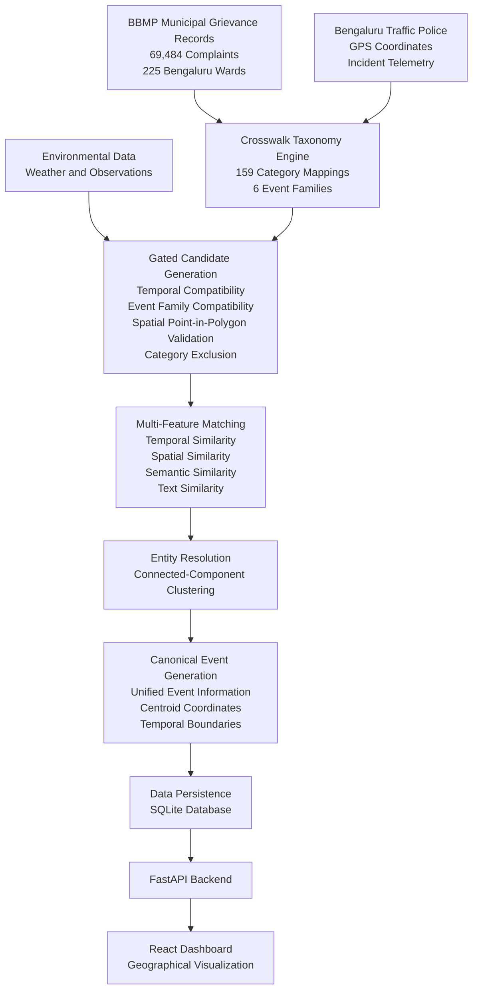

# LOCALYN
### Hyperlocal Multi-Agency Urban Public Intelligence Platform

**Spatio-Temporal Entity Resolution & Civic Data Fusion for Bengaluru**

LOCALYN is an urban public intelligence platform designed to integrate fragmented municipal, traffic, and environmental information into unified, location-aware civic event records.

The platform applies cross-agency taxonomy alignment, spatial and temporal filtering, multi-feature similarity matching, and graph-based entity resolution to identify observations that may represent the same real-world urban incident.

**Geographical Focus:** Bengaluru Metropolitan Region, Karnataka, India.

---

## 1. Overview

Urban information is distributed across multiple government departments and independent reporting systems. A single real-world incident may be recorded differently by different agencies, creating fragmented and potentially duplicated information.

LOCALYN addresses this challenge through multi-source data integration and spatio-temporal entity resolution.

The project works with the following data sources:

- **BBMP Municipal Grievance Records:** 69,484 complaints from 2023–2025 across 225 Bengaluru wards.
- **Bengaluru Traffic Police (BTP):** Traffic incident telemetry containing geographical coordinates and incident information.
- **Environmental Data:** Weather and environmental observations providing additional context about urban conditions.

The objective is to transform independent observations into consolidated representations of urban incidents.

---

## 2. System Architecture

LOCALYN follows a multi-stage data processing architecture.



---

## 3. Core Methodology

### 3.1 Crosswalk Taxonomy Engine

Municipal and traffic agencies use different classification systems to describe urban incidents.

LOCALYN uses a crosswalk taxonomy to align agency-specific categories with a common event classification structure.

The mapping framework consists of:

- 159 category mappings.
- Direct, probable, ambiguous, and excluded mapping classifications.
- 6 cross-agency event families.

Examples of event families include potholes, waterlogging, fallen trees, and other relevant municipal and traffic-related incidents.

### 3.2 Gated Candidate Generation

Before calculating similarity between observations, LOCALYN reduces the candidate search space using multiple compatibility conditions.

The process includes:

- **Temporal compatibility:** A maximum 48-hour matching window.
- **Event family compatibility:** Identification of compatible event categories.
- **Spatial validation:** Ray-casting Point-in-Polygon (PIP) validation to determine geographical containment within Bengaluru ward boundaries.
- **Category exclusion:** Exclusion of municipal categories that are unsuitable for cross-agency fusion.

This filtering process reduces irrelevant candidate pairs before detailed matching.

### 3.3 Multi-Feature Similarity Matching

Candidate observations are evaluated using four independent similarity features.

The weighted matching function is:

\[
S = 0.25T + 0.35G + 0.25M + 0.15X
\]

Where:

| Feature | Weight | Description |
|---|---:|---|
| Temporal Similarity | 25% | Compatibility between incident timestamps |
| Spatial Similarity | 35% | Geographical proximity between observations |
| Semantic Similarity | 25% | Similarity between event meanings |
| Text Similarity | 15% | Similarity between textual descriptions |

The resulting score represents the compatibility of two observations for potential event association.

### 3.4 Entity Resolution and Canonical Event Generation

Following candidate matching, related observations are organized into connected components using graph-based clustering.

Each cluster represents a group of observations potentially associated with a common real-world incident.

LOCALYN generates a canonical event representation containing:

- Consolidated event information.
- Geographical centroid coordinates.
- Temporal boundaries.
- Associated source observations.

This provides a unified representation of incidents that would otherwise remain distributed across independent reporting systems.

---

## 4. Key Capabilities

- Multi-source urban data ingestion.
- Cross-agency taxonomy alignment.
- Temporal and geographical candidate filtering.
- Multi-feature similarity-based matching.
- Graph-based entity resolution.
- Canonical event generation.
- Bengaluru ward-level geographical processing.
- Centralized urban event visualization.

---

## 5. Technology Stack

| Layer | Technologies |
|---|---|
| Frontend | React, JavaScript, Vite |
| Backend | Python, FastAPI |
| Database | SQLite |
| Geospatial Processing | GeoJSON, Point-in-Polygon |
| NLP | spaCy and text-processing components |
| Mapping | Leaflet, OpenStreetMap |
| API Communication | REST APIs |

---

## 6. Repository Structure

```text
LOCALYN/
│
├── backend/
│   ├── app/
│   │   ├── api/
│   │   ├── classifier/
│   │   ├── database/
│   │   ├── evaluation/
│   │   ├── fusion/
│   │   ├── geo/
│   │   │   └── data/
│   │   ├── ingestion/
│   │   └── nlp/
│   │
│   ├── tests/
│   ├── requirements.txt
│   └── README.md
│
├── frontend/
│   ├── public/
│   ├── src/
│   │   ├── pages/
│   │   ├── services/
│   │   ├── App.jsx
│   │   └── App.css
│   ├── package.json
│   └── vite.config.js
│
├── LOCALYN_BBMP_2023_2024_BTP_Crosswalk.csv
├── LOCALYN_Matching_Methodology.md
├── clean_db.py
├── run_fusion_benchmark.py
├── run_pipeline.py
├── .env.example
├── .gitignore
└── README.md
```

---

## 7. Installation and Setup

### Prerequisites

- Python 3.10 or later.
- Node.js and npm.
- Git.

### Step 1: Clone the Repository

```bash
git clone https://github.com/kumarkc57/LOCALYN.git
cd LOCALYN
```

### Step 2: Configure Environment Variables

Create a local environment file using the provided template.

**Windows PowerShell:**

```powershell
Copy-Item .env.example .env
```

Configure the required API credentials and local settings in `.env`.

Never commit actual API keys or credentials to GitHub.

### Step 3: Start the Backend

From the project root:

```powershell
python -m venv .venv
.venv\Scripts\activate
pip install -r backend/requirements.txt
python -m uvicorn backend.app.main:app --host 0.0.0.0 --port 8000 --reload
```

### Step 4: Start the Frontend

Open a separate terminal:

```powershell
cd frontend
npm install
npm run dev
```

The frontend development server will display its local URL in the terminal.

---

## 8. API Documentation

LOCALYN uses a FastAPI backend to expose application functionality through REST APIs.

When the backend is running, the interactive API documentation is available at:

`http://localhost:8000/docs`

---

## 9. Research and Development

LOCALYN explores the application of spatio-temporal entity resolution and cross-agency information fusion to urban public intelligence.

The research focuses on:

- Heterogeneous municipal data integration.
- Cross-agency taxonomy alignment.
- Spatial and temporal candidate filtering.
- Multi-feature similarity-based entity resolution.
- Graph-based event clustering.
- Canonical representation of urban incidents.

The project investigates how fragmented administrative observations can be correlated into more coherent representations of real-world urban events.

---

## 10. Project Scope

| Attribute | Description |
|---|---|
| Project | LOCALYN |
| Domain | Urban Public Intelligence |
| Geographical Focus | Bengaluru Metropolitan Region |
| Primary Data | Municipal, traffic, and environmental observations |
| Research Area | Spatio-Temporal Entity Resolution |
| Application | Civic Information Integration |

---

## 11. Contributors

Developed as an academic engineering project.

Kumar K C,
Ayush Gowda,
Tarun C L

---

*LOCALYN — Connecting fragmented urban information into a unified view of the city.*
