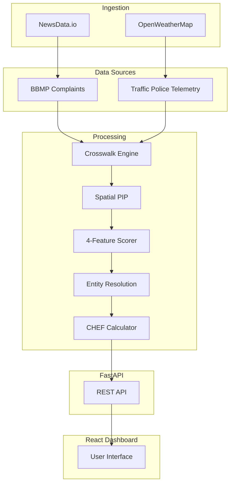

# Architecture Overview

The system consists of three logical layers:

1. **Data Sources** – BBMP municipal grievance records and BTP traffic‑police telemetry. Optional ingestors pull news and weather data.
2. **Processing Pipeline** – Crosswalk taxonomy engine, spatial point‑in‑polygon (PIP) filter, 4‑feature scorer, entity‑resolution clustering, and the CHEF confidence calculator.
3. **Application Layer** – FastAPI backend exposing REST endpoints and a React/Vite dashboard for interactive exploration.

The Mermaid diagram from the README is reproduced here for quick reference:

